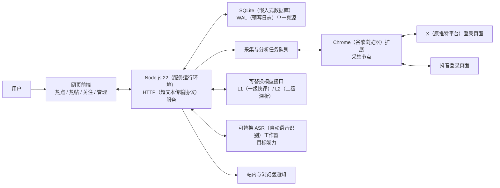
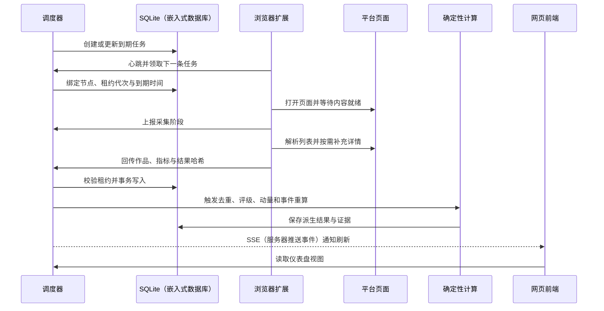

# AIP（人工智能脉冲）TDD（技术设计文档）

## 文档控制

| 项目 | 内容 |
|---|---|
| 文档状态 | 当前技术设计基线 |
| 版本 | 1.0 |
| 最后更新 | 2026-08-01 |
| 产品基线 | [AIP_MASTER_REQUIREMENTS.md](./AIP_MASTER_REQUIREMENTS.md) |
| 实施状态 | [PENDING_IMPLEMENTATION.md](./PENDING_IMPLEMENTATION.md) |
| 适用范围 | 第一版本地运行与单实例服务器部署 |

> 本文只描述当前产品基线对应的技术方案。标记为“已实现”表示代码已存在，不等于已通过真实平台或生产环境验收；标记为“待完成”表示发布前仍需实施或验证。历史架构文件不得覆盖本文。

## 一、设计目标与约束

### 1.1 技术目标

1. 在复用用户平台登录态的前提下，持续采集 X（原推特平台）和抖音公开内容。
2. 以确定性代码完成去重、快照、热帖评级和热点阶段计算，模型不可成为核心链路单点故障。
3. 每个页面结论可以追溯到作品、作者、指标快照、任务、规则版本和冻结证据。
4. 本地脱离 Codex（编程智能体）独立运行，并可部署为单服务写实例。
5. 平台故障相互隔离；缺失数据、失败和积压必须显式暴露。

### 1.2 技术约束

- 运行环境为 Node.js 22（服务运行环境）。
- 第一版业务唯一真源为 SQLite（嵌入式数据库）。
- 仅允许一个服务写实例；需要水平扩展时必须先迁移数据库和任务协调机制。
- 平台采集依赖用户本地 Chrome（谷歌浏览器）登录会话，不能保证电脑休眠或浏览器退出期间的时效。
- X（原推特平台）和抖音没有在第一版中使用官方全量数据接口，因此页面结构变化属于必须监控的外部风险。
- 只采集公开可见内容，不执行平台写操作。

### 1.3 技术非目标

- 不实现多租户、跨地域高可用或多个并行写服务。
- 不绕过验证码、风控、私密权限或平台登录限制。
- 不把大模型用于确定性等级替代、指标补全或虚构缺失证据。
- 不在第一版长期保存完整视频和音频文件。

## 二、总体架构



### 2.1 部署单元

| 单元 | 当前实现 | 职责 | 状态 |
|---|---|---|---|
| 网页前端 | `index.html`、`assets/radar-app.js`、`assets/radar.css` | 三个主页面、管理抽屉、状态与证据展示 | 已实现基础版本 |
| 应用服务 | `server.mjs` | 静态文件、接口、调度、重算、通知与实时事件 | 已实现 |
| 数据访问层 | `lib/database.mjs` | 数据表、事务、迁移、归档、完整性和备份支撑 | 已实现 |
| 采集运行时 | `lib/collector-runtime.mjs` | 平台状态、任务阶段、暂停恢复和失败分类 | 已实现 |
| 浏览器扩展 | `extension/` | 领取任务、打开平台页、解析、详情补充和回传 | X 已贯通；抖音待真实验收 |
| 确定性计算 | `lib/grading.mjs`、`lib/event-engine.mjs`、`lib/dashboard.mjs` | 热度评级、动量、事件阶段和视图模型 | 已实现 |
| 模型运行时 | `lib/model-runtime.mjs` | 路由、预算、分析任务和结果版本 | 已实现接口，待真实供应商验收 |
| 运维脚本 | `scripts/`、`Dockerfile`、`compose.yaml` | 迁移、备份和单实例容器运行 | 已有基础，待生产验收 |

### 2.2 核心设计决策

| 决策编号 | 决策 | 原因 | 触发重新评估的条件 |
|---|---|---|---|
| ADR-001 | 第一版使用 SQLite（嵌入式数据库）单写实例 | 部署简单，满足个人单实例产品的数据规模和事务要求 | 多用户、多个服务实例或单机吞吐成为瓶颈 |
| ADR-002 | 使用本地浏览器扩展采集 | 复用真实登录态，降低云端登录和风控复杂度 | 获得合规稳定的平台数据接口 |
| ADR-003 | 核心等级和事件门槛由确定性代码计算 | 保证可复算、可测试、低成本且不受模型波动影响 | 不变；模型只提供辅助解释和歧义建议 |
| ADR-004 | 热度等级与动量分离 | 区分长期质量和短期传播速度 | 不变 |
| ADR-005 | 正式评级首次证据冻结 | 防止作者后续基线变化改写历史判断 | 只允许通过版本化审计规则更正错误证据 |
| ADR-006 | 原始细粒度快照保留 7 天后压缩 | 控制数据库增长，同时保留事件期内增速证据 | 需要更长回放窗口且存储预算允许 |
| ADR-007 | L1（一级快评）自动、L2（二级深析）手动 | 兼顾覆盖、成本和人工控制 | L2（二级深析）成本与准确率达到自动化门槛 |

## 三、端到端数据流

### 3.1 采集闭环



### 3.2 关键步骤

1. 调度器按平台开关、来源优先级和到期时间建立任务。
2. 扩展通过受限节点令牌发送心跳并领取任务；任务领取后记录节点、租约代次和到期时间。
3. 扩展依次报告打开页面、等待内容、滚动、详情补充和提交等阶段。
4. 服务端只接受当前节点和当前租约代次的结果；使用载荷哈希识别完全重复与冲突重复。
5. 成功结果在同一持久化过程内更新作品当前值并新增不可变指标快照。
6. 确定性计算从原始作品和快照生成等级、动量、事件、通知和分析任务。
7. 前端通过 SSE（服务器推送事件）获得变化提示，再拉取新的仪表盘数据；数据库仍是唯一真源。

### 3.3 手动采集

手动采集只负责把符合条件的任务提前到当前队列，不得删除运行中任务或创建相同实体、平台和任务类型的重复活动任务。接口返回实际入队数、已存在数和平台暂停原因，前端不得只显示无依据的“已触发”。

## 四、采集任务与平台状态机

### 4.1 任务优先级

从高到低：

1. 用户手动采集和正在跟进的高等级内容。
2. T3（现象级）、T2（爆款）关联的事件追踪。
3. 高优先级关注博主与可信官方来源。
4. 普通关注博主与候选来源。
5. 监控词查询和最近 7 天历史补采。

同优先级按计划执行时间升序排列。每个平台单独维护队列和暂停状态，避免一个平台失败阻塞另一个平台。

### 4.2 任务状态

| 状态 | 含义 | 允许的下一状态 |
|---|---|---|
| `queued`（已排队） | 等待节点领取 | `leased`（已租用）、`paused`（已暂停） |
| `leased`（已租用） | 已绑定节点和租约 | `running`（运行中）、`queued`（重新排队）、`failed`（失败） |
| `running`（运行中） | 扩展正在采集 | `complete`（完成）、`failed`（失败）、`queued`（重新排队） |
| `complete`（完成） | 结果通过校验并持久化 | 终态；后续复采生成新任务 |
| `failed`（失败） | 本轮失败且记录错误类型 | 按退避生成新任务或转 `paused`（已暂停） |
| `paused`（已暂停） | 平台或配置阻止执行 | 恢复后转 `queued`（已排队） |

扩展内部阶段为 `leased`（已租用）、`opening_page`（打开页面）、`waiting_content`（等待内容）、`scrolling`（滚动采集）、`detail_enrichment`（详情补充）、`submitting`（提交）、`complete`（完成）和 `failed`（失败）。

### 4.3 失败分类与策略

| 错误 | 策略 | 页面要求 |
|---|---|---|
| `AUTH_REQUIRED`（需要登录） | 暂停对应平台，等待用户重新登录 | 显示登录失效和恢复操作 |
| `CHALLENGE_REQUIRED`（需要验证） | 暂停对应平台，不自动绕过 | 显示平台验证阻断 |
| `RATE_LIMITED`（受到限流） | 暂停或延迟平台任务 | 显示限流时间和积压 |
| `PAGE_TIMEOUT`（页面超时） | 按作者逐级退避重试 | 显示最近失败和重试时间 |
| `PARSER_CHANGED`（解析结构变化） | 记录样本、告警并限制重复失败 | 显示解析器异常，不显示为无新帖 |
| `ACCOUNT_UNAVAILABLE`（账号不可用） | 降低该来源调度频率并保留审计 | 标明账号不可访问 |
| `NO_NEW_CONTENT`（没有新内容） | 正常完成，不视为故障 | 显示最近成功采集时间 |
| `NETWORK_ERROR`（网络错误） | 短退避后重试 | 显示节点或网络异常 |

普通失败退避为 15 分钟、30 分钟、1 小时和 6 小时封顶。平台风险错误可直接暂停平台。租约过期任务只有在确认无当前有效执行者后才能重新排队。

## 五、数据设计

### 5.1 数据库设置

- 使用 `better-sqlite3`（SQLite 同步驱动）。
- 开启 WAL（预写日志）、外键约束和 5 秒忙等待。
- 结构变更使用版本化迁移，不在运行时静默重建业务表。
- 接口写操作在应用进程内串行提交；多步骤状态变化使用事务。
- 备份使用数据库一致性备份流程，并在完成后运行完整性检查。

### 5.2 核心实体

| 实体或表 | 关键标识 | 主要内容 | 保留策略 |
|---|---|---|---|
| `creators`（作者） | 平台与作者标识 | 关注状态、语言、来源类型、粉丝快照 | 长期保留 |
| `monitor_rules`（监控规则） | 规则标识与版本 | 词、平台、语言、分类、优先级和启停状态 | 历史版本保留 |
| `jobs`（任务） | 任务标识 | 平台、类型、实体、优先级、租约、重试和错误 | 审计期内保留 |
| `posts`（作品） | 平台与平台作品标识 | 正文、作者、时间、链接、当前公开指标和来源 | 长期保留 |
| `snapshots`（指标快照） | 作品与采集时间 | 每次真实采集的公开指标 | 细粒度 7 天 |
| `snapshot_daily_summaries`（每日快照摘要） | 作品与日期 | 首次值、最高值、最终值和增长量 | 长期保留 |
| `grade_evidence`（评级证据） | 作品与首次正式等级 | 冻结基线、粉丝数、门槛版本、输入值和证据哈希 | 永久保留 |
| `grade_history`（等级历史） | 作品、等级与时间 | 等级升级和审计更正 | 永久保留 |
| `threshold_versions`（门槛版本） | 平台、体量层和版本 | X（原推特平台）校准结果与抖音固定门槛 | 永久保留 |
| `events`（事件） | 事件标识 | 事件键、阶段、强度、来源与覆盖状态 | 长期保留 |
| `event_history`（事件历史） | 事件、阶段与时间 | 升级、冷却和证据 | 永久保留 |
| `source_registry`（来源登记） | 平台与来源标识 | 官方、关注、候选、可信度和观察窗口 | 长期保留 |
| `analysis_tasks`（分析任务） | 任务标识与内容版本 | 任务类型、优先级、模型路由和状态 | 长期保留 |
| `analysis_results`（分析结果） | 内容版本与分析类型 | 结构化模型输出、证据和供应商信息 | 长期保留 |
| `usage_ledger`（用量账本） | 请求或预留标识 | 预算预留、实际用量、价格版本和日期 | 长期保留 |
| `transcripts`（逐字稿） | 作品与版本 | 文本、语言、供应商、证据状态 | 长期保留文本 |
| `collector_nodes`（采集节点） | 节点标识 | 心跳、令牌状态、版本和能力 | 长期保留审计 |
| `notifications`（通知） | 实体、阶段与渠道 | 去重键、投递状态和时间 | 长期保留 |
| `audit_entries`（审计记录） | 审计标识 | 冲突结果、拒绝原因和人工更正 | 长期保留 |

部分集合通过统一载荷结构持久化，同时保留可索引的标识、平台、状态和时间列。新查询若成为高频路径，应增加明确索引，不能依赖全量解析 JSON（结构化数据文本）。

### 5.3 唯一性与幂等

- 作品唯一键：平台加平台作品标识。
- 快照唯一性：作品、采集时间和指标载荷哈希共同约束；完全重复不得制造新增长。
- 活动任务唯一性：平台、任务类型和目标实体在活动状态下只允许一个有效任务。
- 结果验收：节点标识、租约代次、租约有效期和结果哈希全部匹配后才可写入。
- 通知唯一性：实体、阶段和渠道组合；阶段升级可以生成新通知。
- 模型结果版本：内容版本、分析类型、提示版本和模型路由共同确定，避免普通指标变化重复花费。

### 5.4 保留与压缩

每天维护任务将超过 7 天的细粒度快照在事务中压缩成每日摘要。压缩前后必须保持：每日首次值、最高值、最终值、增长量、正式评级冻结证据和事件阶段证据。临时媒体在处理完成后 24 小时内删除；逐字稿文本和少量关键证据帧可长期保留。

## 六、确定性计算设计

### 6.1 热帖评级

算法规则以产品基线第七章为准，代码入口为 `lib/grading.mjs`。计算顺序：

1. 验证平台、作者、作品时间、粉丝数和历史样本质量。
2. 从目标作品发布前、同平台最近最多 20 条有效作品计算核心指标中位数。
3. 计算 R（账号内相对倍数）和 M（赞粉比），选择 Tier（粉丝体量层）门槛版本。
4. 历史少于 5 条、粉丝缺失或 X（原推特平台）尚未校准时只生成候选。
5. 首次达到正式等级时原子写入冻结证据和等级历史。
6. 后续只使用冻结分母更新分子；等级只能升级，错误撤销必须记录审计。

评级函数必须保持纯输入到纯输出，数据库写入和时间获取在函数外完成，以便固定证据复算。

### 6.2 动量

从连续快照计算最近 2 小时和此前 2 小时的增长速度，并同时检查总量增长比例。覆盖不足、快照陈旧或有效窗口不足时返回“数据不足”，不得推断冷却。

### 6.3 事件聚合

代码入口为 `lib/event-engine.mjs` 和 `lib/discovery-events.mjs`。流程：

1. 从帖子提取主体、产品、版本、具体变化、动作和时间。
2. 生成可解释事件键，禁止只用“人工智能”或公司名等宽泛词聚合。
3. 建立首发、引用、转述、加工和跨平台转载关系。
4. 按独立作者、去重帖子、热帖等级、新增作者和时间窗口计算阶段。
5. 作者矩阵、同母帖搬运和同作者重复发帖只计为一个独立传播主体。
6. 升级时保存事件历史和证据；覆盖不足时禁止冷却。

模型可以提出事件字段和归并建议，但确定性门槛和最终可见阶段必须经过代码校验。

### 6.4 计算版本

评级公式、门槛、事件键和阶段规则均需保存版本。修改规则时：

1. 新数据使用新版本。
2. 已冻结正式评级不静默重写。
3. 如需回算，生成独立迁移和影响报告，并保留旧结果。
4. 页面证据显示实际使用的规则版本。

## 七、模型与逐字稿设计

### 7.1 路由模型

模型运行时按任务类型配置供应商、模型、接口地址、协议、环境变量密钥名、价格版本和预算。五类独立路由为：相关性复核、事件辅助、L1（一级快评）、L2（二级深析）和 ASR（自动语音识别）。某一路由不可用不得阻断其他路由或确定性链路。

### 7.2 L1（一级快评）

- T1（小爆）及以上自动入队，优先级为 T3（现象级）、T2（爆款）、T1（小爆），同级最新优先。
- 请求前在事务中预留当日预算和分析版本名额，请求完成后结算实际用量；失败也结算不可回收成本。
- 默认上限为北京时间每日 0.50 美元或 100 个版本，以先达到者为准。
- 输出先通过严格 JSON（结构化数据文本）模式、字段数量、长度、枚举和范围校验，再保存和展示。
- 输入正文和逐字稿用数据边界包裹，系统提示明确禁止执行内容中的指令。

### 7.3 L2（二级深析）

第一版由用户在详情页手动触发。运行器可以调用任意已配置模型，也允许用户使用 Codex（编程智能体）完成本地分析后回填结构化结果；不得硬依赖 Claude Code（克劳德编程工具）。自动化开关在第一版保持关闭。

### 7.4 逐字稿

T2（爆款）和 T3（现象级）视频生成逐字稿任务。工作器目标流程为：验证媒体来源、获取临时媒体、执行 ASR（自动语音识别）、保存带供应商和版本的逐字稿、删除临时媒体、触发新的 L1（一级快评）内容版本。聊天模型接口不能冒充语音识别接口返回逐字稿。

### 7.5 降级策略

- 无密钥：任务保持待配置，核心页面正常。
- 预算耗尽：停止当日自动 L1（一级快评），允许次日恢复和人工 L2（二级深析）。
- 超时或无效结构：记录失败原因和原始响应哈希，不展示不合格结果。
- 无逐字稿：允许元数据分析，但明确降低置信度并显示证据限制。

## 八、接口设计

### 8.1 接口分组

| 分组 | 主要接口 | 调用方 | 权限 |
|---|---|---|---|
| 健康与会话 | `/api/health`、`/api/auth/status`、`/api/auth/login` | 页面、监控器 | 健康接口公开最小信息；其他按环境认证 |
| 页面读取 | `/api/dashboard`、`/api/notifications`、`/api/discovery-events`、`/api/trending-keywords` | 网页前端 | 管理员会话 |
| 配置管理 | `/api/monitoring-rules`、`/api/collection-settings`、`/api/follows`、`/api/model-routes` | 网页前端 | 管理员会话和 CSRF（跨站请求伪造防护） |
| 手动操作 | `/api/collect`、`/api/analysis/run-next`、关键词重算接口 | 网页前端 | 管理员会话和 CSRF（跨站请求伪造防护） |
| 节点管理 | `/api/collector-nodes` | 网页前端 | 管理员会话和 CSRF（跨站请求伪造防护） |
| 扩展采集 | `/api/extension/heartbeat`、`/api/extension/progress`、`/api/extension/jobs/next`、`/api/extension/result`、`/api/extension/fail` | 浏览器扩展 | 受限节点令牌与节点标识 |
| 实时刷新 | `/api/events` | 网页前端 | 管理员会话；SSE（服务器推送事件） |

### 8.2 通用约定

- 请求和响应使用 JSON（结构化数据文本），字符编码为 UTF-8（统一码转换格式 8 位）。
- 写接口必须验证内容类型、体积、字段类型和允许值。
- 错误响应至少包含稳定错误码、用户可读中文说明和可关联的请求标识。
- 时间在存储和接口中使用 UTC（协调世界时）时间戳，页面按用户时区展示。
- 列表接口必须支持稳定排序；数据量增长后增加游标分页。
- 不向前端或扩展返回服务器环境变量中的模型密钥。

### 8.3 仪表盘响应

`/api/dashboard` 应一次返回页面所需的热点、热帖、关注、平台健康摘要、覆盖声明和更新时间，避免前端自行拼装相互矛盾的派生状态。详情和大体量时间线可使用独立接口按需加载。

## 九、安全设计

### 9.1 信任边界

1. 平台页面、作品正文、作者名、媒体地址和逐字稿均为不可信输入。
2. 浏览器扩展是受限采集节点，不是管理员。
3. 网页管理员可以修改配置和触发任务，但不能读取模型明文密钥。
4. 模型供应商是外部处理器，发送内容必须限制为完成任务所需的最小证据。

### 9.2 控制措施

- 生产环境管理员使用会话认证，写接口验证 CSRF（跨站请求伪造防护）令牌。
- 扩展令牌只允许采集相关接口，支持首次配对、轮换、宽限、撤销和节点绑定。
- 前端将正文、作者名、逐字稿和模型结果以纯文本渲染，禁止将内容直接注入 HTML（超文本标记语言）。
- 媒体策略只接受 HTTPS（加密网页传输协议）和允许的平台域名，拒绝本机、私网、重定向到内网和未知协议。
- 云端页面与本地扩展桥接时只接受精确配置的来源，不使用通配来源。
- 日志和审计不得写入管理员密码、节点完整令牌或模型密钥。
- 模型提示把用户内容放在明确证据边界内，并验证结构化输出，降低提示注入风险。

### 9.3 威胁与验证

| 风险 | 防护 | 必测场景 |
|---|---|---|
| 伪造采集结果 | 节点令牌、租约代次、结果哈希 | 错节点、过期租约、冲突重复 |
| 跨站写操作 | 会话和 CSRF（跨站请求伪造防护） | 缺失或错误令牌 |
| 恶意正文执行 | 纯文本渲染和内容安全策略 | 脚本、事件属性和危险链接 |
| 服务器端请求伪造 | 媒体域名和地址解析策略 | 本机、私网、重定向和编码地址 |
| 提示注入 | 证据隔离、固定系统提示和输出校验 | 正文要求模型泄密或改变规则 |
| 密钥泄漏 | 环境变量和响应过滤 | 配置读取、错误栈和日志导出 |

## 十、可靠性与可观测性

### 10.1 健康指标

页面和健康接口至少提供：

- 服务启动时间、数据库可读写状态和迁移版本。
- 各平台最近节点心跳、最近成功、最近失败、当前阶段和暂停原因。
- 排队、运行、暂停、失败和过期租约数量。
- 最近 15 分钟与 1 小时的成功率、错误分类和回传作品数。
- 最后一次确定性重算时间、模型队列和预算状态。
- 覆盖是否足以执行热点冷却判断。

### 10.2 结构化日志

运行日志至少包含时间、级别、模块、请求或任务标识、平台、节点标识、错误码和耗时。作品正文、完整令牌和密钥不得进入日志。生产环境应由进程管理器收集标准输出和错误输出，并设置轮转。

### 10.3 故障恢复

- 服务启动时检查数据库、迁移和未完成租约。
- 已过期且无活动节点的租约重新排队，未过期租约不重复执行。
- 平台暂停状态持久化，服务重启不能自动抹掉风险原因。
- SSE（服务器推送事件）断开不影响数据写入；前端重连后重新读取仪表盘。
- 模型或逐字稿工作器退出不影响采集和确定性计算。

## 十一、部署与运行

### 11.1 本地开发

```bash
npm install
npm run migrate:dry-run
npm run migrate
npm start
```

默认监听 `127.0.0.1:4173`，数据库位于 `data/aip-monitor.sqlite`。浏览器扩展以开发者模式加载 `extension/` 目录，配置服务地址和节点令牌。

### 11.2 本地长期运行

目标方案是在 macOS（苹果桌面操作系统）使用 `launchd`（系统服务管理器）托管服务：登录或开机启动、异常自动重启、固定工作目录、日志轮转和环境变量文件。发布前必须执行以下故障演练：

1. 主动结束服务进程，确认自动恢复。
2. 重启电脑，确认服务和扩展重新连接。
3. 退出浏览器，确认页面显示节点离线和数据缺口。
4. 服务恢复后确认过期任务正确重新排队且没有重复快照。

当前状态：启动脚本存在，但可靠的系统服务托管尚未完成真实验收，属于 PRD-OPS-001 的 P0（阻断级）缺口。

### 11.3 单实例服务器

容器部署使用 `Dockerfile` 和 `compose.yaml`：

```bash
cp .env.example .env
docker compose up -d --build
```

生产要求：

- 只运行一个写服务实例。
- 数据目录挂载持久化磁盘，不写入容器临时层。
- 反向代理提供 HTTPS（加密网页传输协议）和可信域名。
- 设置管理员密码、允许的页面来源和一次性节点引导令牌。
- 配置健康检查、自动重启、日志轮转和每日一致性备份。
- 浏览器采集节点可以在本地，通过加密连接访问服务器。

### 11.4 备份与恢复

`npm run backup` 生成一致性备份并执行完整性检查。恢复流程必须在停止写入后进行：保留损坏文件、恢复最近有效备份、运行迁移和完整性检查、启动只读核验、再恢复采集。发布前至少完成一次备份恢复演练并记录恢复点和恢复耗时。

## 十二、测试策略

### 12.1 测试层级

| 层级 | 范围 | 关键验证 |
|---|---|---|
| 单元测试 | 评级、动量、事件门槛、监控词、媒体策略 | 固定输入、边界、缺失证据和版本稳定性 |
| 数据库测试 | 迁移、事务、唯一约束、冻结证据、压缩和备份 | 重复写入、回滚、旧数据导入和完整性 |
| 接口测试 | 认证、配置、手动触发、扩展结果和仪表盘 | 权限、错误码、幂等和响应结构 |
| 扩展测试 | 页面解析、任务阶段、详情补充和平台错误 | 真实页面样本、结构变化和 7 天截止 |
| 端到端测试 | 调度到页面展示 | X（原推特平台）和抖音真实任务各自贯通 |
| 安全测试 | 会话、令牌、媒体和提示注入 | 非法来源、伪造结果、危险地址和恶意正文 |
| 运维测试 | 重启、断网、浏览器退出、备份恢复 | 无重复、状态清晰和自动恢复 |

### 12.2 自动检查

```bash
npm test
npm run check
```

代码合并前自动检查必须零失败。因环境缺少真实浏览器或平台登录而跳过的测试需要单独列入真实验收，不能用“自动测试通过”替代。

### 12.3 产品需求追溯

测试名称或测试说明必须引用对应需求编号，例如 `PRD-GRADE-001`。P0（阻断级）需求至少具备一个正常场景、一个边界场景和一个失败或降级场景。

## 十三、性能与容量基线

第一版以单用户、单写服务和少量采集节点为容量边界。初始工程目标：

- 健康接口和无大查询的页面接口在本机正常负载下应快速响应，不被模型请求阻塞。
- 单次采集结果按事务提交，模型调用在持久化核心结果之后异步执行。
- 每个平台每小时最多回溯 20 位陌生作者；超出任务保留积压而非丢弃。
- 大列表逐步采用限制条数和游标分页；前端不得一次渲染全部历史快照。
- 当数据库、队列或接口超过基线时先以真实指标定位瓶颈，再决定索引、归档或 PostgreSQL（关系型数据库）迁移，不提前引入分布式复杂度。

正式上线前需要用实际一周数据测量数据库增长、仪表盘响应、任务吞吐和快照压缩耗时，再冻结容量数值。

## 十四、当前实施差距与技术风险

| 编号 | 差距或风险 | 影响 | 处理优先级 | 完成标准 |
|---|---|---|---|---|
| GAP-001 | 抖音真实任务尚未成功入库 | 双平台核心目标未闭环 | P0（阻断级） | 作者任务和查询任务各成功回传，页面可见真实作品与快照 |
| GAP-002 | 本地服务缺少可靠系统托管验收 | 终端关闭后采集链路中断 | P0（阻断级） | 开机自启、异常重启和状态恢复演练通过 |
| GAP-003 | X（原推特平台）解析结构变化和账号不可用错误仍存在 | 覆盖率和时效下降 | P0（阻断级） | 错误率可观测，已知页面样本稳定解析，失败不伪装成空数据 |
| GAP-004 | X（原推特平台）M（赞粉比）门槛样本不足 | 正式等级只能候选 | P1（核心级） | 满足 14 天、200 条作品和 20 位作者后生成版本化门槛 |
| GAP-005 | 模型路由未完成真实密钥与费用验收 | 无自动“为什么爆了” | P1（核心级） | 至少一个供应商完成预算、结构校验、超时和降级测试 |
| GAP-006 | 逐字稿工作器未贯通 | 视频分析证据不足 | P2（增强级） | 真实视频完成获取、识别、存储、清理和二次快评 |
| GAP-007 | 生产服务器环境未验收 | 云端可用性和安全未知 | P1（核心级） | 域名、加密访问、持久化、备份恢复和节点远程连接通过 |

## 十五、需求到技术映射

| 产品需求 | 主要技术章节 | 核心实现位置 |
|---|---|---|
| PRD-NAV-001、PRD-FOLLOW-001、PRD-UI-001 | 二、八 | `index.html`、`assets/radar-app.js`、`assets/radar.css` |
| PRD-COL-001、PRD-COL-002、PRD-COL-003 | 三、四、十 | `server.mjs`、`lib/collector-runtime.mjs`、`extension/` |
| PRD-DATA-001、PRD-DEPLOY-001 | 五、十一 | `lib/database.mjs`、`scripts/`、`compose.yaml` |
| PRD-GRADE-001、PRD-MOM-001 | 六 | `lib/grading.mjs`、`lib/dashboard.mjs` |
| PRD-EVENT-001 | 六 | `lib/event-engine.mjs`、`lib/discovery-events.mjs` |
| PRD-TERM-001 | 八 | `lib/monitoring-terms.mjs`、`server.mjs` |
| PRD-AI-001、PRD-AI-002、PRD-ASR-001 | 七 | `lib/model-runtime.mjs`、`lib/media-policy.mjs` |
| PRD-OPS-001 | 十、十一 | `server.mjs`、`start.command`、待增加的系统服务配置 |
| PRD-SEC-001 | 八、九 | `lib/security.mjs`、`lib/media-policy.mjs`、`extension/background.js` |
| PRD-NOTIFY-001 | 七、十 | `lib/notifications.mjs`、`server.mjs` |

## 十六、技术变更流程

1. 产品规则变化先修改 PRD（产品需求文档）并更新需求编号或版本。
2. 架构、数据模型、接口或安全边界变化再修改本文，并记录影响范围和迁移策略。
3. 实施方案拆入 `PLAN.md` 或新的版本计划，代码和测试引用需求编号。
4. 完成后更新 `PENDING_IMPLEMENTATION.md`，只把真实验证过的结果标记为已完成。
5. 任何与本文冲突的历史文件不得直接用于开发；需要采纳时先合并到当前基线。
